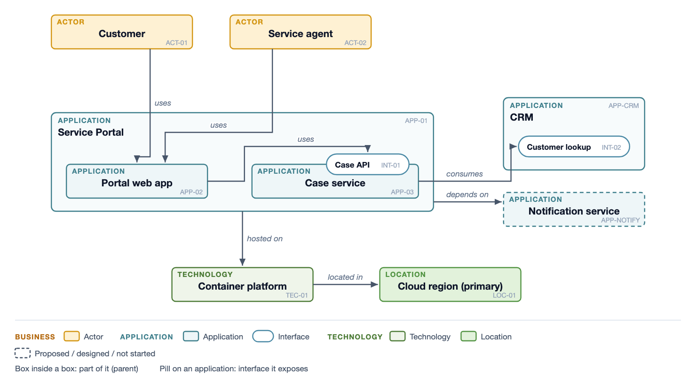
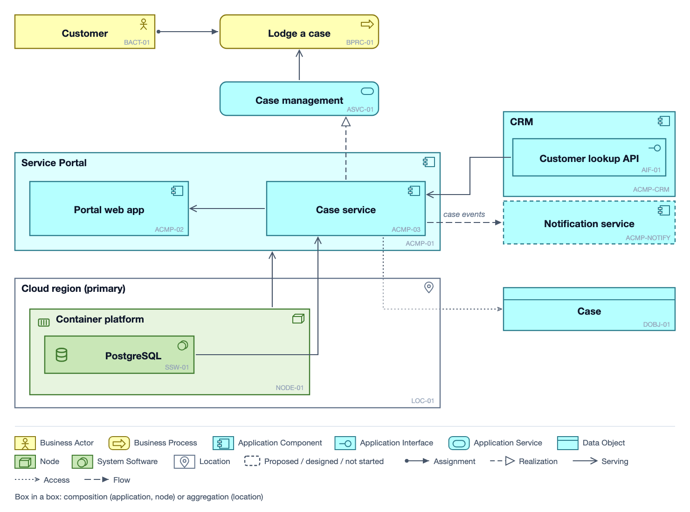
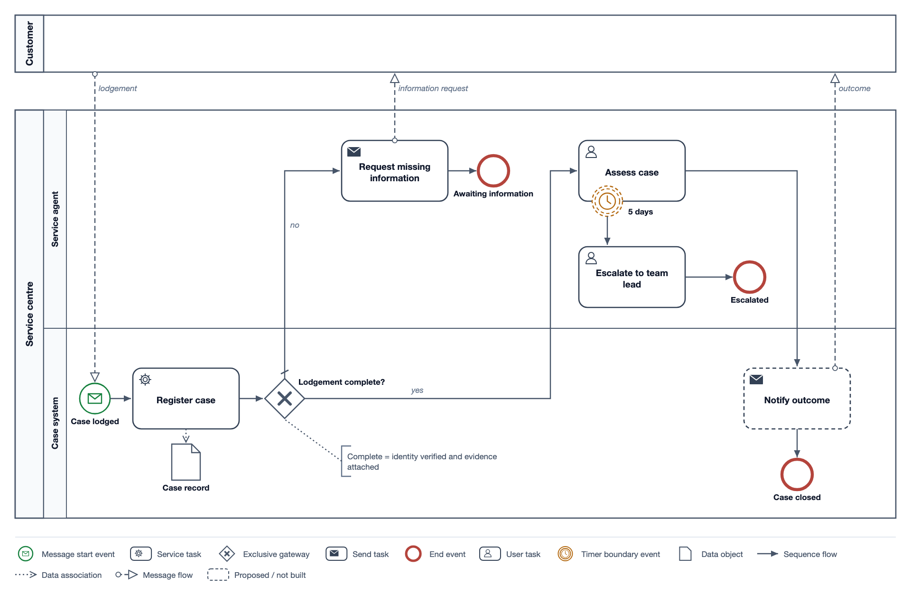

# arch-diagram

A Claude Code plugin for print-grade architecture diagrams. Claude lays out each diagram by hand as inline SVG in one house style, renders it, looks at the render and fixes it before handing it over. The output drops straight into markdown, a Word document or a PDF without any diagramming tool.

It covers four ways of drawing:

- **House diagram types.** Ten recipes, each with layout constants and an SVG skeleton: deployment, system context, integration, data flow, sequence, deploy path, steps, state, swimlane and phases.
- **C4.** System context, container, component, deployment and dynamic views, following C4's rules: one level per diagram, every element labelled with its type and technology, every line labelled, and a key on every diagram.
- **Enterprise architecture.** CoreEA, the metamodel OrbusInfinity uses, with its viewpoints (Application Context, Application Integration, Logical Data, Infrastructure, Capability, Business Strategy, Project Context, Risk Catalogue, Organization diagrams and the CRUD matrix), plus the open frameworks ArchiMate 3.2, the TOGAF Content Metamodel and the Essential Meta-Model. Every view is drawn from one validated object model, so an object has the same id, type and name in every view, and the model loads into the person's EA tool.
- **BPMN 2.0.** Pools, lanes, tasks, events, gateways, message and data flows, validated against BPMN's flow rules and exported as BPMN XML with its layout.



## Install

```
/plugin marketplace add warrendeanlangeveldt/arch-diagram
/plugin install arch-diagram@arch-diagram
```

Then ask for a diagram in plain words: "draw the deployment for this service", "a C4 container diagram of the API", "the Application Integration Diagram for the SAD", "an ArchiMate application cooperation view", "the TOGAF Application/Data matrix", "a BPMN diagram of case lodgement". The skill picks the type or framework, reads its recipe and draws it.

## Requirements

- Google Chrome or Chromium, used headless to render each diagram to PNG so Claude can check it visually. On macOS the standard install is found automatically; elsewhere `google-chrome` or `chromium` on the PATH is used, or set `CHROME_PATH`.
- Python 3.9 or later for the EA library and the icon tools (standard library only).
- Optional: `xmllint`, which the tests use to validate the XML exports against the official schemas.

## Frameworks

| Framework | Status | Notation | Exports |
|---|---|---|---|
| CoreEA | OrbusInfinity's metamodel | House EA box, with interfaces as pills | CSV catalogue; OrbusInfinity import |
| ArchiMate 3.2 | Open standard, The Open Group | ArchiMate rectangle notation with type symbols and the standard line styles for all eleven relationships | ArchiMate exchange format with diagrams |
| TOGAF Content Metamodel | Open standard, The Open Group | House EA box; catalogs and matrices as tables | CSV catalogue |
| Essential Meta-Model | Open source, Essential Project | House EA box | CSV catalogue carrying Essential meta-class and slot names |
| BPMN 2.0 | Open standard, OMG | BPMN | BPMN 2.0 XML with diagram interchange |

`validate()` checks a model against its framework and reports every problem at once: unknown types, ids that don't carry the type's prefix, missing endpoints, parent loops, and relationships the framework doesn't allow between two types. ArchiMate relationships are checked against the full ArchiMate 3.2 relationship table. BPMN models are checked for flows that cross pools, message flows inside a pool, events used the wrong way round and misused default flows. Views refuse to draw an object or line that isn't in the model, and warn when a view strays outside its viewpoint.

## Getting the model into an EA tool

- ArchiMate tools (Archi, Sparx EA, BiZZdesign, BOC ADOIT, MEGA): the exchange file carries elements, relationships, properties and each view laid out as drawn. It validates against the Open Group schema.
- BPMN tools (Camunda Modeler, bpmn.io, Signavio, Bizagi, ARIS): BPMN XML that validates against the OMG schema.
- OrbusInfinity: an import through its REST API. `ea.py orbus discover` reads the tenant's object and relationship types and drafts a mapping file; `plan` writes the import payload (every request, objects first, for review); `push` loads it within the API's rate limit and keeps a ledger, so a second push updates the same objects instead of duplicating them. It has been tested against a local implementation of the published API contract, not yet against a live tenant, so the first push should go to a sandbox model.
- Essential and spreadsheets: object and relationship CSVs.

## Icons

Diagrams use the official AWS, Azure and Google Cloud architecture icons for platform services, and 64 generic glyphs for everything else: people, browsers, SaaS products, on-premises kit, and open-source software such as Kafka or Postgres. The vendors' terms allow their icons in diagrams and documentation but not redistribution in a tool, so the plugin doesn't ship them. `icons.py fetch aws --accept-terms` downloads the current pack from the vendor's own page into a local cache once you have accepted its terms. Until a pack is fetched, its components draw with the matching generic glyph.

`icons.py resolve "Cosmos DB"` shows which icon a component gets. Product logos are never drawn.

## What's in it

```
skills/arch-diagram/
  SKILL.md                 routing, design system, icons, procedure
  icons.svg                64 generic stroke glyphs
  references/              one recipe per diagram type; c4.md; ea.md, coreea.md,
                           archimate.md, togaf.md, essential.md, bpmn.md; icons.md; exports.md
  scripts/ea.py            validate, rules, viewpoints, export, orbus
  scripts/icons.py         fetch, search, resolve and inline platform icons
  scripts/ealib/           views, metamodels, BPMN, exports, Orbus import
  scripts/coreea_lib.py    the 1.x CoreEA API, now running on ealib
  scripts/metamodels/      CoreEA, ArchiMate, TOGAF and Essential definitions
  scripts/examples/        one model per framework, its view scripts and output
tests/                     python3 -m unittest discover -s tests
```

## Design rules

- One accent colour for the one or two things the reader should see first; no shadows or gradients. Platform icons keep their own colours.
- Arrows are orthogonal, labelled, and stop short of their target.
- Every diagram is rendered and checked for clipped text, arrowheads piercing boxes and labels crossing lines before it is handed over.
- The theme is a small set of tokens. Override it with your own brand colours.





## Licence

MIT for the plugin. The ArchiMate relationship table in `metamodels/archimate.json` is taken from Appendix B of the ArchiMate 3.2 Specification, as encoded by the Archi project. Vendor icon packs are downloaded by each user under the vendor's own terms.
