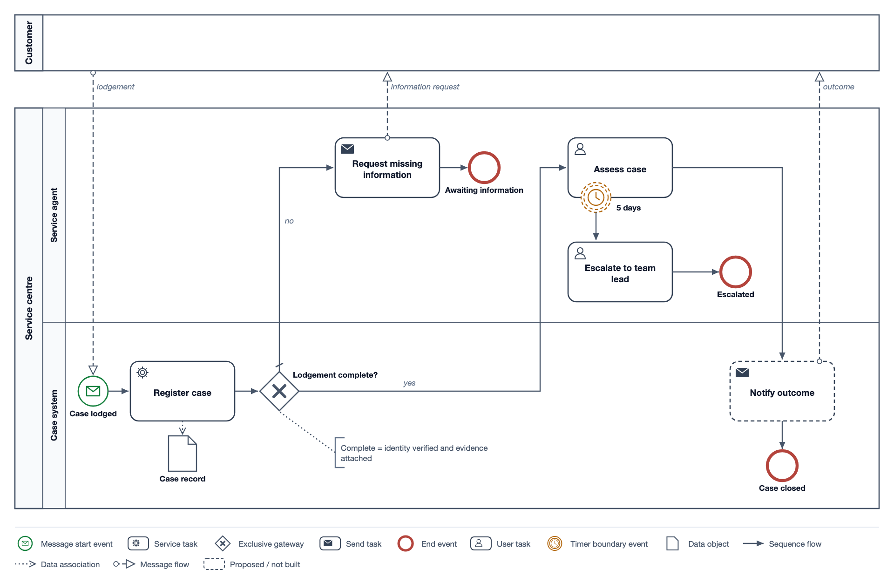

# BPMN 2.0

OMG's process notation. Use it when the request is about how work flows:
who does which step, in what order, on which events and decisions. For "who
does what" at a glance without BPMN semantics, the house `swimlane` recipe is
lighter. Read `ea.md` for the model-first workflow; BPMN uses the same file
with `"metamodel": "bpmn"`.

## Model

| Objects | Notes |
|---|---|
| `participant` | a pool, with one process |
| `lane` | `parent`: a pool or a lane |
| `task`, `userTask`, `serviceTask`, `sendTask`, `receiveTask`, `manualTask`, `scriptTask`, `businessRuleTask`, `callActivity`, `subProcess` | `parent`: the lane, pool or sub-process |
| `startEvent`, `endEvent`, `intermediateCatchEvent`, `intermediateThrowEvent` | `trigger`: message, timer, error, signal, escalation, conditional, compensation, terminate, link, cancel (each event type allows its own subset) |
| `boundaryEvent` | `attachedTo` an activity; `interrupting: false` draws dashed; no `parent` |
| `exclusiveGateway`, `parallelGateway`, `inclusiveGateway`, `eventBasedGateway`, `complexGateway` | |
| `dataObject`, `dataStore`, `textAnnotation` | |

| Relationships | Rules `validate()` enforces |
|---|---|
| `sequenceFlow` | between flow nodes in one pool or sub-process; none out of an end event, none into a start or boundary event; `default: true` only from an exclusive, inclusive or complex gateway or an activity, once per source; an event-based gateway leads only to catch events or receive tasks |
| `messageFlow` | between two different pools, from a pool, activity or throwing event to a pool, activity or catching event |
| `association` | to or from a text annotation |
| `dataInput`, `dataOutput` | data object or store into an activity or throw event; activity or catch event out to data |

Ids are any XML identifier. Short prefixes (`T-`, `E-`, `G-`, `L-`, `P-`) keep
scripts readable. If the model has pools, every flow node sits in one, and a
pool with lanes takes its nodes in the lanes. A model without pools is one
process.

`validate()` also returns warnings for smells that are legal but usually
wrong: a start event that leads nowhere, an unreachable activity, a gateway
that neither splits nor joins, unnamed outgoing flows of a decision.

## Drawing

```python
from ealib.bpmn import BpmnView, write_bpmn_xml
v = BpmnView(model, "V1", title="…", theme=make_theme(width=960))
pool = v.pool("P-SVC", 16, 116, 928, 430)          # returns the content box
lane = v.lane("L-SYS", pool["x"], 346, pool["w"], 200)
e = v.event("E-START", 100, 420)                    # centre
t = v.task("T-REG", 140, 388)                       # top-left, 112 x 64
g = v.gateway("G-1", 300, 420, label="above-right") # centre
v.flow([(e["r"], 420), (t["x"] - 2, 420)], ("E-START", "sequenceFlow", "T-REG"))
y = v.legend(pool["b"] + 20); v.save(y + 4, "out")
write_bpmn_xml(model, "out/process.bpmn", view=v)
```

Notation: pools and lanes with vertical name bands; rounded tasks with their
type marker top-left, a thick border on call activities and a [+] on collapsed
sub-processes; start events thin and green, intermediate events double-ringed,
end events thick and red, with the trigger symbol inside (filled when
throwing); gateways as diamonds with their marker; sequence flow solid with a
filled arrow, a slash on the default flow and a diamond on conditional flows
out of activities; message flow dashed from a small circle to a hollow arrow;
associations dotted. `flow(..., label=(x, y))` prints the flow's `name` or
`condition`.

Layout: time runs left to right; one row per lane; tasks 112 × 64 with gaps
of at least 36; events and gateways centred on the row; message flows
vertical between pools. Label gateways where no flow leaves
(`above-right`, `below-left` …). Pools are usually wider than the 740 house
canvas: set `make_theme(width=960)` and keep the 16px margins.

## Example

`scripts/examples/bpmn/lodgement.py`: two pools, lanes, a timer boundary event,
message flows, a data object and an annotation, plus its BPMN XML.


