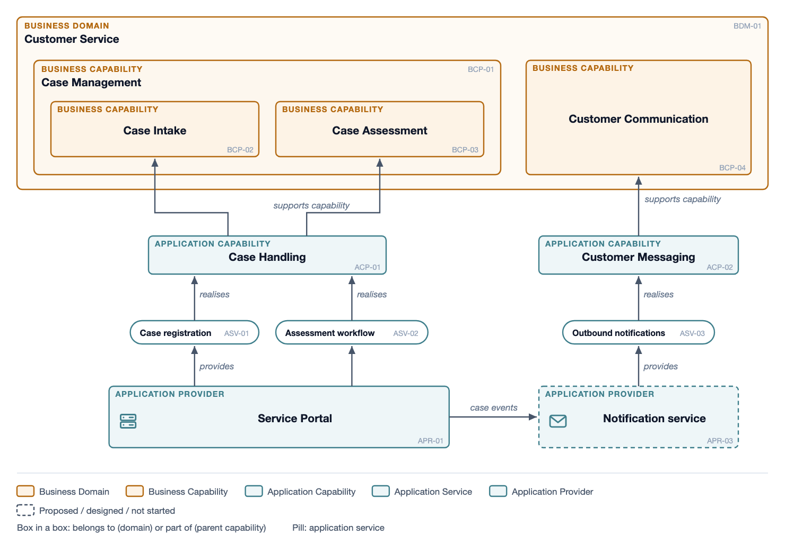

# Essential Meta-Model

The Essential Project's open-source meta-model, built around business
capabilities and the applications, information and technology that support
them. Use it when the person runs Essential or wants capability-led portfolio
views. Read `ea.md` first. Views use the house EA box.

## Classes

`"metamodel": "essential"`. Each type carries its Essential meta-class in
the catalogue's `class` column (`Application_Provider`,
`Business_Capability` …), so the export maps straight onto an Essential
repository.

| Layer | Types |
|---|---|
| Strategy | Business Driver, Business Goal, Business Objective |
| Business | Business Domain, Business Capability, Value Stream, Business Process, Physical Process, Business Activity, Business Event, Product Type, Product, Group Actor, Individual Actor, Group Business Role, Individual Business Role, Site |
| Information | Information Concept, Information View, Information Representation, Data Subject, Data Object, Data Representation |
| Application | Application Capability, Application Service, Application Provider, Composite Application Provider, Application Function, Application Deployment |
| Technology | Technology Domain, Technology Capability, Technology Component, Technology Product, Technology Node, Supplier |
| Planning | Strategic Plan, Project |

Essential separates the logical from the physical at each layer: a Business
Process is realised by Physical Processes performed by actors at sites; an
Application Service is provided by Application Providers; a Technology
Component is implemented by Technology Products. Model at the level the view
needs and no lower.

## Relationships

Each verb names the Essential slot or relation class it stands for (see
`metamodels/essential.json`, field `essential`), so a reviewer can find it in
the repository. The common ones:

| Verb | Joins | Essential |
|---|---|---|
| `realises` | Business Process → Business Capability; Application Service → Application Capability; Technology Component → Technology Capability | `realises_business_capability`, `realises_application_capabilities`, `realisation_of_technology_capability` |
| `supports capability` | Application Capability → Business Capability | `app_cap_supports_bus_cap` |
| `provides` | Application Provider → Application Service | `provides_application_services` |
| `supports process` | Application Provider → Physical Process | `APP_PRO_TO_PHYS_BUS_RELATION` |
| `uses information` | Application Provider → Information Representation, with `crud` | `APP_PRO_TO_INFOREP_RELATION` |
| `sends information to` | Application Provider → Application Provider | static application provider usage |
| `implements` | Physical Process → Business Process; Technology Product → Technology Component | `implements_business_process`, `implements_technology_components` |
| `performed by` | Physical Process → actor or role | `process_performed_by_actor_role` |
| `plans change to` | Strategic Plan → element, planning action in `note` | `PLAN_TO_ELEMENT_RELATION` |

`parent` is decomposition: sub-capabilities, sub-processes, contained
providers.

## Views

`ea.py viewpoints essential` lists them: Business Capability Model, Business
Capability to Application, Value Stream, Business Process Model, Organisation
Summary, Application Provider Summary, Application Information Dependency,
Information Model, Technology Reference Model, Technology Platform, Strategic
Plan Roadmap, the Application Portfolio catalog and the Application to
Information CRUD matrix.

The CRUD matrix is `matrix()` over `uses information`, whose `crud` field
fills the cells.

## Example

`scripts/examples/essential/views.py`: Business Capability to Application, and
the CRUD matrix.

