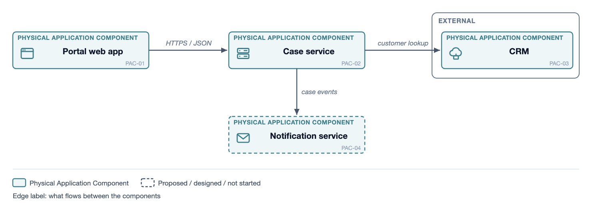
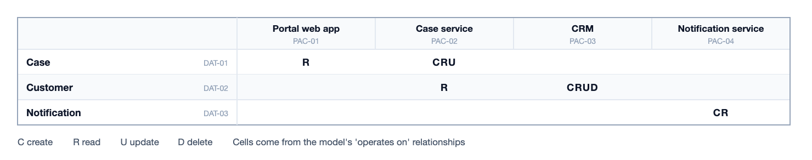

# TOGAF Content Metamodel

The Open Group's TOGAF Standard (10th Edition) defines the content an
architecture produces: the metamodel entities and their relationships, and
the catalogs, matrices and diagrams each ADM phase delivers. It does not
define a notation, so views use the house EA box: layer colour, type label,
name, id. Read `ea.md` first.

## Entities

`"metamodel": "togaf"`. `ea.py types togaf` prints them with prefixes.

| Layer | Entities |
|---|---|
| Motivation | Driver, Goal, Objective, Measure, Principle, Requirement, Constraint, Assumption |
| Business | Organization Unit, Actor, Role, Business Capability, Value Stream, Course of Action, Business Service, Function, Process, Event, Control, Product, Contract, Service Quality, Location |
| Data | Data Entity, Logical Data Component, Physical Data Component |
| Application | Information System Service, Logical Application Component, Physical Application Component |
| Technology | Technology Service, Logical Technology Component, Physical Technology Component |
| Implementation | Work Package, Gap |

Services (Business Service, Information System Service, Technology Service)
can be drawn as pills.

## Relationships

The verbs follow the metamodel's own wording, read source to target: an Actor
`belongs to` an Organization Unit and `performs task in` a Role; a Process
`realizes` a Business Service; a Logical Application Component `implements` an
Information System Service and `operates on` a Data Entity; a Physical
Application Component `realizes` a Logical one and `is hosted on` a Physical
Technology Component; a Work Package `delivers` components and `closes` a Gap.
`metamodels/togaf.json` holds the full list with the types each joins, and
`ea.py rules togaf A B` answers for one pair. A project that has agreed further
relationships with its architecture board passes them to
`validate(model, extra_verbs={"approves": (["Role"], ["Data Entity"])})`.
Pick the right entity type before reaching for a new verb.

`parent` is decomposition within one type: a sub-function, a child capability,
a sub-process.

## Artifacts

`View(..., viewpoint="<artifact>")` checks the entity types against the
artifact. `ea.py viewpoints togaf` lists them with their phase.

| Phase | Diagrams | Matrices and catalogs |
|---|---|---|
| A | Value Chain, Solution Concept | Stakeholder Map matrix |
| B | Business Footprint, Business Capability Map, Organization Decomposition, Functional Decomposition, Process Flow, Event | Organization/Actor catalog, Actor/Role matrix |
| C | Conceptual Data, Logical Data, Data Dissemination, Data Security, Application Communication, Application and User Location, Application Use-Case, Processes/Application Realization | Data Entity/Business Function matrix, Application/Data matrix, Application/Organization matrix, Application Portfolio catalog |
| D | Environments and Locations, Platform Decomposition, Network Computing/Hardware | Application/Technology matrix, Technology Portfolio catalog |
| E | Project Context, Benefits | |
| Requirements Management, Preliminary | | Requirements catalog, Principles catalog |

Matrices are tables, not diagrams: `matrix()` with `cells_from(verb, rows,
cols)`, so every cell traces to a relationship. A cell shows the relationship's
`note` (put C/R/U/D there for the Application/Data matrix). Catalogs are the
CSV export (`ea.py export model.json --format csv`), filtered to the artifact's
types.

Layout recipes: Application Communication follows `integration`; Environments
and Locations and Network Computing follow `deployment`; Process Flow follows
`swimlane` (or use BPMN); Business Capability Map and Functional Decomposition
are nested grids; Project Context follows `steps` (work package left, what it
delivers right).

## Example

`scripts/examples/togaf/views.py`: an Application Communication diagram and
the Application/Data matrix.

